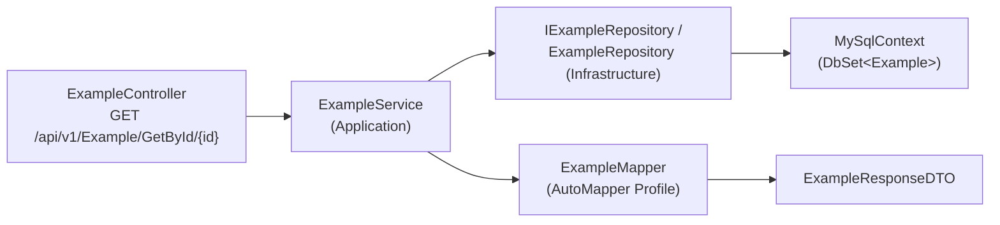
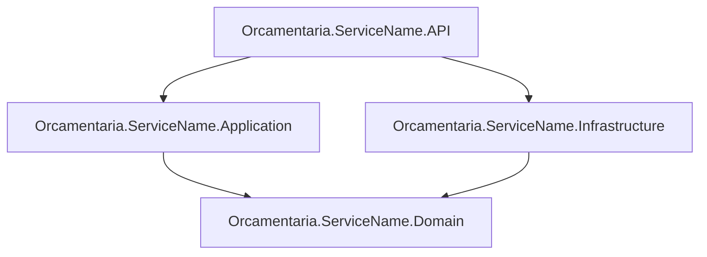

# 🧩 Orcamentaria.Template

Template oficial de **dotnet new** para criação de novos microsserviços do ecossistema **Orcamentaria**. Não é um serviço executável em si — é a estrutura de partida (scaffold) que gera a arquitetura em camadas padrão do ecossistema, já cabeada com a biblioteca compartilhada `Orcamentaria.Lib`, a cada novo serviço criado.

---

## 🎯 Objetivo

Padronizar a criação de microsserviços do ecossistema Orcamentaria, evitando que cada novo serviço comece do zero. Ao instalar este repositório como template do .NET CLI e executá-lo, o desenvolvedor recebe pronto:

1. Uma solução em **4 projetos** (API, Application, Domain, Infrastructure) já referenciados entre si e com o nome do novo serviço aplicado automaticamente;
2. As dependências para `Orcamentaria.Lib.Domain`, `Orcamentaria.Lib.Application` e `Orcamentaria.Lib.Infrastructure` já declaradas nos `.csproj` corretos;
3. Um exemplo completo de fatia vertical (entidade `Example`, do Model ao Controller) demonstrando o padrão de camadas a ser seguido;
4. `Startup.cs` já configurado com a inicialização comum do ecossistema (`CommonDI`), incluindo autenticação JWT, Swagger, CORS e Entity Framework Core com MySQL;
5. `Dockerfile`, `compose.yaml` e um script de inicialização de banco (`mysql-init-scripts`) prontos para adaptação.

Isso foi confirmado no arquivo `.template.config/template.json`, que declara este diretório como um template do .NET (`dotnet new`) com `"sourceName": "ServiceName"` — ou seja, todo texto literal `ServiceName` encontrado em nomes de pastas, nomes de arquivos e conteúdo de arquivos é substituído pelo nome informado ao gerar um novo serviço.

---

## 🧰 Tecnologias

| Tecnologia | Versão | Finalidade |
|---|---|---|
| C# / .NET | 8 (`net8.0`) | Linguagem e runtime, usado em todos os 4 projetos |
| ASP.NET Core Web API | `Microsoft.NET.Sdk.Web` | Hospedagem HTTP na camada API |
| `Orcamentaria.Lib.Domain` | `*` (sempre a última) | Referenciado em Domain, Application e API |
| `Orcamentaria.Lib.Application` | `*` (sempre a última) | Referenciado na API |
| `Orcamentaria.Lib.Infrastructure` | `*` (sempre a última) | Referenciado na API — fornece `CommonDI` usado em `Startup.cs` |
| Entity Framework Core | 8.0.0 | ORM usado na camada Infrastructure |
| `MySql.EntityFrameworkCore` | 8.0.0 | Provider MySQL para o EF Core |
| AutoMapper | 14.0.0 | Mapeamento entre entidades e DTOs (referenciado em Domain) |
| FluentValidation | 12.0.0 | Validação (referenciado em Domain e Application) |
| Motor de templates do .NET CLI (`dotnet new`) | — | Mecanismo de geração do novo serviço a partir deste repositório |

---

## 🏗️ Arquitetura

O template segue a mesma **arquitetura em camadas** usada pelos demais serviços do ecossistema:

- **Domain**: modelos (`Models`), DTOs (`DTOs`), contratos de repositório e serviço (`Repositories`, `Services`) e mapeamentos AutoMapper (`Mappers`). Referencia apenas `Orcamentaria.Lib.Domain`.
- **Application**: implementação das regras de negócio (`Services`). Referencia `Orcamentaria.Lib.Domain` e o projeto Domain.
- **Infrastructure**: `DbContext` (EF Core + MySQL), `EntityTypeConfiguration` e implementação dos repositórios. Referencia o projeto Domain — não referencia `Orcamentaria.Lib.Infrastructure` diretamente (essa referência fica só na API).
- **API**: Controllers, `Program.cs`/`Startup.cs` (composition root), chaves públicas (`Keys/`) para validação de token e configuração da aplicação. É o único projeto que referencia os três pacotes `Orcamentaria.Lib.*`.

Fluxo de dependência entre camadas: `API → Application → Domain` e `Infrastructure → Domain`, sempre apontando para dentro — o mesmo padrão observado no `Orcamentaria.APIGetaway` e demais serviços do ecossistema.

---

## 📁 Estrutura do Projeto

```text
Orcamentaria.Template/
├── .template.config/
│   └── template.json                      # Configuração do template dotnet new (sourceName: "ServiceName")
├── Orcamentaria.ServiceName.API/
│   ├── Controllers/v1/ExampleController.cs # Endpoint de exemplo (GET /api/v1/Example/GetById/{id})
│   ├── Keys/                               # public_key_service.pem / public_key_user.pem (validação JWT)
│   ├── Program.cs / Startup.cs             # Bootstrap e injeção de dependências (CommonDI)
│   └── appsettings*.json                   # Configuração da aplicação
├── Orcamentaria.ServiceName.Application/
│   └── Services/ExampleService.cs          # Implementação de exemplo de IExampleService
├── Orcamentaria.ServiceName.Domain/
│   ├── DTOs/Example/ExampleResponseDTO.cs
│   ├── Mappers/ExampleMapper.cs            # Profile do AutoMapper (Example <-> ExampleResponseDTO)
│   ├── Models/Example.cs
│   ├── Repositories/IExampleRepository.cs
│   └── Services/IExampleService.cs
├── Orcamentaria.ServiceName.Infrastructure/
│   ├── Configurations/ExampleConfiguration.cs # IEntityTypeConfiguration<Example> (tabela T_EXAMPLE)
│   ├── Contexts/MySqlContext.cs               # DbContext com DbSet<Example>
│   └── Repositories/ExampleRepository.cs      # Implementação de IExampleRepository via EF Core
├── mysql-init-scripts/
│   └── create-example-db.sql               # Script de exemplo (schema/tabelas de pessoa)
├── Orcamentaria.ServiceName.sln
├── Dockerfile
├── compose.yaml                            # MySQL + serviço gerado, para uso local
├── .dockerignore / .gitignore
└── README.md
```

---

## 🏷️ O Placeholder `ServiceName`

O texto literal `ServiceName` foi encontrado nos seguintes arquivos deste repositório: `.template.config/template.json`, `compose.yaml`, `Dockerfile`, `Orcamentaria.ServiceName.sln`, todos os `.csproj`, `Program.cs`, `Startup.cs`, `launchSettings.json` e todos os arquivos `.cs` das camadas Domain/Application/Infrastructure/API (namespaces e `using`s). Ele aparece também nos nomes das 4 pastas de projeto (`Orcamentaria.ServiceName.API`, `.Application`, `.Domain`, `.Infrastructure`).

Isso é consistente com a configuração do template (`.template.config/template.json`):

```json
{
  "sourceName": "ServiceName",
  "sources": [
    { "source": "./", "target": "Orcamentaria.ServiceName" }
  ],
  "primaryOutputs": [
    { "path": "Orcamentaria.ServiceName.API/Orcamentaria.ServiceName.API.csproj" },
    { "path": "Orcamentaria.ServiceName.Application/Orcamentaria.ServiceName.Application.csproj" },
    { "path": "Orcamentaria.ServiceName.Domain/Orcamentaria.ServiceName.Domain.csproj" },
    { "path": "Orcamentaria.ServiceName.Infrastructure/Orcamentaria.ServiceName.Infrastructure.csproj" }
  ]
}
```

Ou seja: ao gerar um novo serviço com o motor de templates do .NET, todo `ServiceName` (em pastas, arquivos, namespaces e configurações) é substituído pelo nome informado — não é necessário fazer essa substituição manualmente.

---

## 🚀 Como Criar um Novo Microsserviço a partir deste Template

### 1. Instalar o template localmente

```bash
cd C:\Users\<seu-usuario>\Documents\Orcamentaria.Template
dotnet new install .
```

Isso registra o template no .NET CLI (identidade `Orcamentaria.MicroserviceTemplate`, nome curto `orcamentaria-microservice`), habilitando o comando `dotnet new orcamentaria-microservice`.

### 2. Gerar o novo serviço

Em uma pasta destino, execute:

```bash
dotnet new orcamentaria-microservice -n PersonService
```

O resultado é a estrutura completa com o nome substituído:

```text
Orcamentaria.PersonService/
 ├── Orcamentaria.PersonService.API/
 ├── Orcamentaria.PersonService.Application/
 ├── Orcamentaria.PersonService.Domain/
 ├── Orcamentaria.PersonService.Infrastructure/
 └── Orcamentaria.PersonService.sln
```

### 3. Atualizar o template após alterações neste repositório

```bash
dotnet new uninstall .
dotnet new install .
```

### 4. Verificar se o template está instalado

```bash
dotnet new list | findstr orcamentaria
```

### 5. Remover o template, se necessário

```bash
dotnet new uninstall Orcamentaria.MicroserviceTemplate
```

---

## 🧱 Ajustes Necessários Após Gerar o Serviço

A substituição de `ServiceName` cobre nomes e namespaces, mas os pontos abaixo, encontrados no conteúdo atual dos arquivos, ainda precisam de atenção manual do desenvolvedor ao adaptar o serviço gerado:

| Item | Onde está | O que ajustar |
|---|---|---|
| Camada de exemplo `Example` | `Model`, `DTO`, `Mapper`, `Repository`, `Service`, `Controller` em todas as 4 camadas | Substituir pela(s) entidade(s) reais do novo serviço, seguindo o mesmo padrão de camadas demonstrado. |
| `ApiGetawayConfiguration.BaseUrl` e `BOOTSTRAPSECRET` | `Orcamentaria.ServiceName.API/appsettings.json` | Vêm marcados com `<<value>>` e devem ser preenchidos por ambiente. |
| Script de banco | `mysql-init-scripts/create-example-db.sql` | Contém um schema de exemplo (tabelas de pessoa); deve ser substituído pelo schema real do novo serviço. |
| Nome do serviço/container no Docker Compose | `compose.yaml` (chave do serviço `ServiceName-a`, `container_name: ServiceName-container`) | Renomear conforme o serviço gerado; ajustar `MYSQL_DATABASE` e a `ConnectionStrings__DefaultConnection` para o schema do novo serviço. |
| Chaves de validação JWT | `Orcamentaria.ServiceName.API/Keys/public_key_service.pem` e `public_key_user.pem` | Mantidas como recurso embarcado (`EmbeddedResource`) — reaproveitar ou substituir conforme as chaves do ambiente de destino. |

---

## 📦 Uso do `Orcamentaria.Lib` no Template

| Pacote | Onde é referenciado | Uso |
|---|---|---|
| `Orcamentaria.Lib.Domain` | Domain, Application e API (`Version="*"`) | Modelos e contratos compartilhados (`Response<T>`, exceptions, validadores) usados pelos DTOs, services e controllers de exemplo. |
| `Orcamentaria.Lib.Application` | API (`Version="*"`) | Implementações compartilhadas usadas pela infraestrutura comum resolvida em `Startup.cs`. |
| `Orcamentaria.Lib.Infrastructure` | API (`Version="*"`) | Fornece a classe estática `CommonDI`, usada em `Startup.cs` para inicializar autenticação JWT, Swagger, CORS, EF Core/MySQL e mensageria. |

Como em outros serviços do ecossistema, os pacotes são referenciados com `Version="*"`, garantindo que a versão mais recente publicada seja usada ao restaurar.

### `Startup.cs`

```csharp
public void ConfigureServices(IServiceCollection services)
{
    CommonDI.AddServiceRegistryHosted(services, Configuration);

    CommonDI.ResolveCommonServicesWithMySql<MySqlContext>(
        serviceName: _serviceName,
        apiVersion: _apiVersion,
        services: services,
        configuration: Configuration,
        customServices: () =>
        {
            Configuration = CommonDI.ResolveConfigs(_serviceName, services, Configuration);
            services.Replace(ServiceDescriptor.Singleton(Configuration));

            services.AddAutoMapper(typeof(ExampleMapper));
            services.AddScoped<IExampleRepository, ExampleRepository>();
            services.AddScoped<IExampleService, ExampleService>();
        });
}

public void Configure(IApplicationBuilder app, IWebHostEnvironment env)
    => CommonDI.ConfigureCommon(_serviceName, _apiVersion, app, env);
```

`CommonDI.ResolveCommonServicesWithMySql<T>` (definida em `Orcamentaria.Lib.Infrastructure`) registra, além do `DbContext<T>` com a connection string `DefaultConnection`, a autenticação JWT (esquemas `userJwt`/`serviceJwt`/`bootstrapJwt` via `smartJwt`), Swagger com esquema Bearer, CORS liberado, cache em memória, `IHttpClientService`, `IServiceRegistryService` e o `HostedService` de configuração em tempo real. O bloco `customServices` é o ponto de extensão onde o novo serviço registra seus próprios mappers, repositórios e services — no template, isso é demonstrado com a fatia `Example`.

---

## 🧩 Camada de Exemplo (`Example`)

O template inclui uma fatia vertical completa como referência de padrão, do banco até o endpoint HTTP:



- `ExampleController.GetById` está protegido com `[Authorize(Roles = "EXAMPLE:READ")]` e retorna `Response<ExampleResponseDTO>`.
- `ExampleService.GetById` busca a entidade via `IExampleRepository`, lança `InfoException` (`ErrorCodeEnum.NotFound`) quando não encontrada, e usa `IMapper` para converter `Example` em `ExampleResponseDTO`.
- `ExampleRepository` consulta `MySqlContext.Examples` e encapsula falhas em `DatabaseException`.
- `ExampleConfiguration` mapeia a entidade `Example` para a tabela `T_EXAMPLE` (colunas `ID`, `NAME`, `ACTIVE`, `ORDER_ID`).

Esse fluxo serve de modelo para as entidades reais que substituirão `Example` em cada novo serviço.

---

## 🐳 Docker e Compose

### `Dockerfile`

Build multi-stage com SDK .NET 8: restaura e publica `Orcamentaria.ServiceName.API`, gerando a imagem final a partir de `mcr.microsoft.com/dotnet/aspnet:8.0`, com `ENTRYPOINT ["dotnet", "Orcamentaria.ServiceName.API.dll"]`. As linhas de `ASPNETCORE_URLS`/`EXPOSE` estão comentadas no template.

### `compose.yaml`

Sobe um container MySQL 8.0 (`MYSQL_DATABASE=example-db`, usuário `user-docker`, exposto na porta `4406`) e o serviço da API (build via `Dockerfile`, porta `5000:5000`), conectando-os pela variável de ambiente `ConnectionStrings__DefaultConnection`. A pasta `mysql-init-scripts` é montada como `docker-entrypoint-initdb.d`, executando o script SQL de exemplo na primeira subida do container MySQL.

```bash
docker compose up --build
```

### `mysql-init-scripts/create-example-db.sql`

Script gerado no MySQL Workbench com um schema de exemplo (`person-db`), contendo as tabelas `T_PERSON`, `T_ADDRESS`, `T_CONTACT` e `T_EMPLOYEE` com seus relacionamentos — serve de referência de convenção de nomenclatura (schema/tabelas em maiúsculas, chaves estrangeiras nomeadas) a ser adaptada ao domínio do novo serviço.

---

## 🧱 Dependências entre Módulos



---

## Configuração local

Nenhum valor real deve existir nos arquivos versionados. Após gerar o serviço a partir deste template, configure via `dotnet user-secrets` ou variáveis de ambiente:

```bash
dotnet user-secrets init --project Orcamentaria.<NomeServico>.API
dotnet user-secrets set "BOOTSTRAPSECRET" "<valor-do-bootstrapsecret>" --project Orcamentaria.<NomeServico>.API
dotnet user-secrets set "ConnectionStrings:DefaultConnection" "Server=localhost;Port=3306;Database=<db>;User=<user>;Password=<senha>;SslMode=Disabled" --project Orcamentaria.<NomeServico>.API
```

Ou crie `Orcamentaria.<NomeServico>.API/appsettings.Development.json` (já ignorado pelo `.gitignore`) com os valores locais. Nunca commite esse arquivo.

---

## 📝 Resumo Executivo

O **Orcamentaria.Template** é o template oficial de scaffolding para novos microsserviços do ecossistema Orcamentaria, distribuído como template do .NET CLI (`.template.config/template.json`, `sourceName: "ServiceName"`). Ele não roda como serviço — ao ser instalado (`dotnet new install .`) e executado (`dotnet new orcamentaria-microservice -n <Nome>`), gera uma solução de 4 camadas (API, Application, Domain, Infrastructure) com o nome do novo serviço já aplicado a pastas, namespaces e arquivos de configuração.

A estrutura gerada já vem com `Startup.cs` cabeado à inicialização comum do ecossistema via `Orcamentaria.Lib.Infrastructure` (`CommonDI`), incluindo autenticação JWT, Swagger, CORS e Entity Framework Core com MySQL, além de uma fatia vertical de exemplo (`Example`) que demonstra o padrão de camadas do Model ao Controller. `Dockerfile`, `compose.yaml` e um script de inicialização de banco completam o ponto de partida, cabendo ao desenvolvedor substituir os artefatos de exemplo pelas entidades reais e preencher as configurações específicas (`ApiGetawayConfiguration`, `BOOTSTRAPSECRET`, connection string) do novo serviço.
